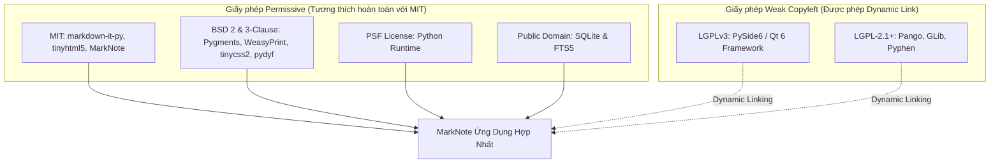

# Báo Cáo Tuân Thủ Giấy Phép & Tính Mã Nguồn Mở (License Compliance)

> **Môn học**: Phần mềm mã nguồn mở (Open Source Software)  
> **Dự án**: MarkNote — Ứng dụng ghi chú Markdown ngoại tuyến (Offline-First)  
> **Giấy phép chính**: MIT License  
> **Kho mã nguồn**: <https://github.com/dotlinux26/marknote>

---

## 1. Cơ Sở Khẳng Định MarkNote Là Phần Mềm Mã Nguồn Mở

Một dự án được xác định là **Phần mềm mã nguồn mở (Open Source Software - OSS)** khi và chỉ khi thỏa mãn đầy đủ các tiêu chuẩn pháp lý và quyền tự do do cộng đồng quốc tế công nhận, cụ thể là:
- **Định nghĩa mã nguồn mở của OSI** (*The Open Source Definition* - 10 tiêu chí).
- **Bốn quyền tự do cốt lõi của FSF** (*The Four Essential Freedoms* của Free Software Foundation).

### 1.1. Đối chiếu với 4 Quyền tự do cốt lõi (FSF)
MarkNote phát hành theo **Giấy phép MIT** (giấy phép được cả FSF và OSI công nhận):
- **Freedom 0 (Quyền sử dụng)**: Bất kỳ ai cũng có quyền chạy MarkNote cho mọi mục đích (cá nhân, học tập, nghiên cứu, thương mại) mà không bị giới hạn.
- **Freedom 1 (Quyền nghiên cứu & sửa đổi)**: Toàn bộ mã nguồn Python (`src/`), giao diện CSS (`assets/themes/`), và script build (`packaging/`) được công khai 100%. Người dùng có thể tìm hiểu cách ứng dụng hoạt động và chỉnh sửa theo nhu cầu.
- **Freedom 2 (Quyền phân phối lại bản sao)**: Người dùng có quyền chia sẻ bản sao mã nguồn hoặc các gói phần mềm đã build (`.AppImage`, file `.zip` portable) cho bất kỳ ai.
- **Freedom 3 (Quyền phân phối phiên bản sửa đổi)**: Người dùng có quyền đóng góp cải tiến (Pull Request) hoặc tự tạo nhánh fork riêng để phát triển và phát hành phiên bản mới ra cộng đồng.

### 1.2. Tính mã nguồn mở nằm ở giấy phép và cách phát hành
Việc chỉ viết code bằng Python hay đẩy code lên GitHub chưa đủ để kết luận là mã nguồn mở nếu thiếu giấy phép rõ ràng. MarkNote khẳng định tính mã nguồn mở nhờ:
1. **Có tệp `LICENSE` chuẩn quốc tế (MIT)** đặt tại gốc repository.
2. **Công khai toàn bộ cấu trúc dự án** (không che giấu mã, không obfuscate, không khóa bản quyền).
3. **Có tài liệu hướng dẫn đóng góp (`CONTRIBUTING.md`)** và **báo cáo phụ thuộc bên thứ ba (`THIRD_PARTY_NOTICES.md`)**.

---

## 2. Bản Chất Bài Toán & Giá Trị Đóng Góp Của Nhóm

MarkNote không đơn thuần là "dùng lại các thư viện có sẵn", mà giải quyết bài toán kỹ thuật cụ thể:

### 2.1. Bài toán thực tế giải quyết
1. **Quản lý tri thức cá nhân ngoại tuyến (Offline-first PKM)**: Không phụ thuộc Internet, không lưu trữ đám mây của bên thứ ba, bảo vệ quyền riêng tư tuyệt đối của dữ liệu.
2. **Tìm kiếm toàn văn siêu tốc (Information Retrieval)**: Khi số lượng note lên tới hàng ngàn, duyệt file thông thường rất chậm. MarkNote tích hợp công nghệ **SQLite FTS5 (Full-Text Search)** để lập chỉ mục từ khóa, hỗ trợ toán tử tìm kiếm nâng cao và lọc tag tức thì.
3. **Soạn thảo và xuất bản chuẩn in ấn (Document Authoring & Publishing)**: Tích hợp Markdown GFM với WeasyPrint để xuất file PDF A4 hoàn chỉnh, tự động sinh mục lục `[[TOC]]` có **đánh số trang thật** và ngắt trang kiểu Microsoft Word.

### 2.2. Phân biệt các thành phần trong dự án
| Thành phần | Nguồn gốc | Vai trò trong hệ thống |
|:-----------|:---------:|:-----------------------|
| **Python 3** | Nền tảng | Ngôn ngữ thực thi logic điều phối |
| **PySide6 / Qt 6** | Thư viện bên ngoài (LGPLv3) | Khung giao diện desktop, rendering Chromium |
| **SQLite FTS5** | Nền tảng tích hợp (Public Domain) | Cơ sở dữ liệu và cỗ máy tìm kiếm toàn văn |
| **markdown-it-py & Pygments** | Thư viện bên ngoài (MIT, BSD-2) | Parser cú pháp Markdown & tô màu code |
| **WeasyPrint & Pango** | Thư viện bên ngoài (BSD-3, LGPL) | Engine chuyển đổi HTML/CSS sang file PDF |
| **Hệ thống module tự phát triển** (`src/db.py`, `src/editor.py`, `src/preview.py`, `src/exporter.py`, `src/theme.py`, `src/settings.py`) | **Nhóm tự xây dựng 100%** | Kết nối kiến trúc, xử lý luồng đồng bộ cuộn, debounce preview, quản lý tag, đổi tên inline, xử lý fallback PDF trên Windows |

---

## 3. Ma Trận Tương Thích Giấy Phép (License Compatibility Analysis)

Một vấn đề quan trọng trong môn học Mã nguồn mở là: **"MarkNote dùng giấy phép MIT, nhưng phụ thuộc vào các thư viện có giấy phép khác thì có hợp lệ không?"**

### 3.1. Phân tích các nhóm giấy phép sử dụng


### 3.2. Tuân thủ giấy phép LGPLv3 của PySide6 / Qt 6
Nhiều sinh viên hay nhầm lẫn rằng nếu dùng thư viện có yếu tố GPL/LGPL thì toàn bộ dự án phải chuyển sang GPL (hiệu ứng "lây lan" - viral license). **Điều này không đúng với LGPLv3**:
1. **Nguyên tắc liên kết động (Dynamic Linking)**:
   - LGPLv3 (GNU Lesser General Public License) cho phép phần mềm thương mại hoặc phần mềm có giấy phép khác (như MIT) liên kết tới thư viện LGPL nếu liên kết dưới dạng thư viện động (`.dll` trên Windows, `.so` trên Linux).
   - Mã nguồn MarkNote gọi các API của PySide6 thông qua Python bindings tiêu chuẩn; không sửa đổi một dòng code nào trong lõi Qt.
2. **Quyền thay thế thư viện của người dùng (Relinking / Library Replacement)**:
   - Trong các bản phân phối đóng gói (PyInstaller onedir hay AppImage), các file thư viện Qt (`Qt6Core.dll`, `Qt6Gui.dll`, `Qt6Widgets.dll`, `Qt6WebEngineCore.dll`) được đặt tách biệt trong thư mục `_internal/`.
   - Người dùng hoàn toàn có quyền và khả năng kỹ thuật thay thế các file DLL này bằng phiên bản Qt tùy biến của họ mà không làm vô hiệu hóa giấy phép MarkNote.
3. **Thông báo quyền tác giả**:
   - Tệp `THIRD_PARTY_NOTICES.md` đã dẫn chiếu đầy đủ thông tin bản quyền và đường dẫn tải mã nguồn gốc của Qt / PySide6.

### 3.3. Tương thích với các giấy phép Permissive (BSD, MIT, PSF, Apache)
- Các giấy phép BSD-2-Clause (Pygments), BSD-3-Clause (WeasyPrint), MIT (markdown-it-py), PSF (Python) chỉ yêu cầu: **Giữ lại thông báo bản quyền gốc và tuyên bố miễn trừ trách nhiệm**.
- Tệp `THIRD_PARTY_NOTICES.md` đã đáp ứng đầy đủ 100% nghĩa vụ này.

---

## 4. Quy Trình Kiểm Kê Giấy Phép Tự Động (License Audit Tooling)

Để đảm bảo tính minh bạch và có bằng chứng số liệu phục vụ báo cáo, nhóm sử dụng công cụ chuẩn công nghiệp `pip-licenses`:

### 4.1. Lệnh kiểm kê trong môi trường ảo
```powershell
# Kích hoạt venv
.\.venv\Scripts\Activate.ps1

# Cài đặt công cụ kiểm kê
pip install pip-licenses

# Xuất báo cáo bảng Markdown
pip-licenses --format=markdown --with-urls

# Xuất dữ liệu JSON phục vụ đối chiếu
pip-licenses --format=json --output-file=docs/licenses_bom.json
```

---

## 5. Cẩm Nang Phản Biện & Trả Lời Vấn Đáp Với Giảng Viên

### Câu 1: "Tại sao nhóm khẳng định MarkNote là phần mềm mã nguồn mở?"
> **Gợi ý trả lời**:  
> *"Thưa Cô/Thầy, MarkNote được công nhận là phần mềm mã nguồn mở dựa trên 3 yếu tố cốt lõi:  
> 1. Toàn bộ mã nguồn dự án được công khai trên GitHub kèm lịch sử commit rõ ràng.  
> 2. Dự án được cấp phép chính thức theo giấy phép MIT (đáp ứng 10 tiêu chuẩn của tổ chức OSI và 4 quyền tự do của FSF).  
> 3. Dự án có đầy đủ hồ sơ tuân thủ giấy phép phụ thuộc bên thứ ba (`THIRD_PARTY_NOTICES.md`) và hướng dẫn đóng góp cộng đồng (`CONTRIBUTING.md`). Tính mã nguồn mở được khẳng định bằng cơ chế pháp lý và quyền của người dùng đối với sản phẩm, không chỉ nằm ở ngôn ngữ lập trình."*

### Câu 2: "Tại sao nhóm dùng PySide6 (LGPLv3) mà lại chọn giấy phép MIT cho MarkNote? Có vi phạm bản quyền Qt không?"
> **Gợi ý trả lời**:  
> *"Dạ thưa Cô/Thầy, việc này hoàn toàn hợp lệ và là thực hành chuẩn trong ngành phần mềm:  
> - Qt được cấp phép theo LGPLv3 (Lesser GPL) chứ không phải GPL thuần túy. Điểm mấu chốt của LGPL là bảo vệ quyền sửa đổi thư viện của người dùng nhưng **cho phép phần mềm ứng dụng kết hợp thông qua cơ chế liên kết động (dynamic linking)**.  
> - MarkNote viết bằng Python, gọi PySide6 qua dynamic binding và không sửa đổi mã nguồn Qt. Khi đóng gói, các file DLL của Qt được giữ riêng biệt trong thư mục `_internal/`, đảm bảo người dùng có quyền thay thế phiên bản Qt bất kỳ lúc nào theo đúng Điều 4 của LGPLv3.  
> - Giấy phép MIT của MarkNote áp dụng cho phần mã nguồn do nhóm phát triển, hoàn toàn tương thích và tôn trọng giấy phép LGPLv3 của tầng giao diện."*

### Câu 3: "Các thư viện Markdown, Pygments, WeasyPrint đều có sẵn, vậy nhóm tự làm được những gì?"
> **Gợi ý trả lời**:  
> *"Thưa Cô/Thầy, giá trị của đề tài nằm ở giải pháp tích hợp và hoàn thiện sản phẩm ứng dụng:  
> 1. Thiết kế kiến trúc hoàn chỉnh từ cơ sở dữ liệu SQLite FTS5, tối ưu chỉ mục tìm kiếm và bộ lọc tag (`src/db.py`).  
> 2. Xử lý logic đồng bộ cuộn (SyncScroll) giữa trình soạn thảo văn bản thô và khung preview Chromium (`src/preview.py`).  
> 3. Tự phát triển bộ mở rộng xuất PDF: tự động sinh mục lục `[[TOC]]` kiểu Word có số trang thực tế, cơ chế ngắt trang và fallback tự động sang CLI engine khi chạy trên các hệ điều hành không có sẵn thư viện C (`src/exporter.py`).  
> 4. Quản lý hệ thống theme CSS hoán đổi tức thì mà không cần khởi động lại ứng dụng (`src/theme.py`).  
> Tận dụng thư viện nguồn mở là nguyên tắc sống còn để tránh 'phát minh lại chiếc bánh xe', điều quan trọng là nhóm đã xây dựng nên một ứng dụng desktop ngoại tuyến hoàn chỉnh, phục vụ tốt người dùng."*
